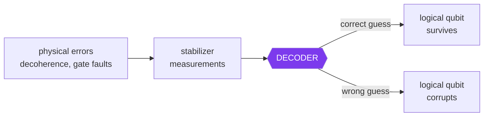
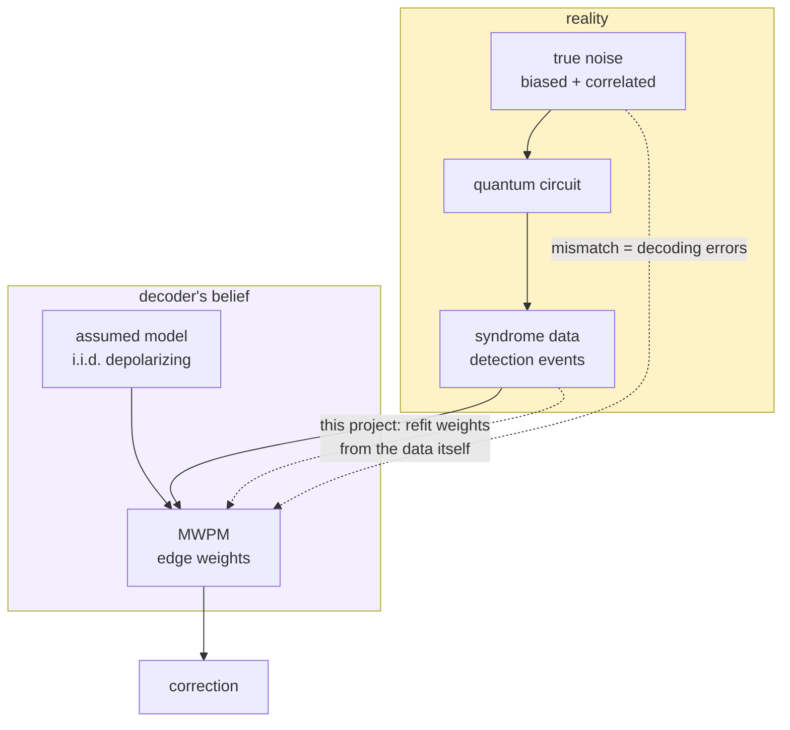
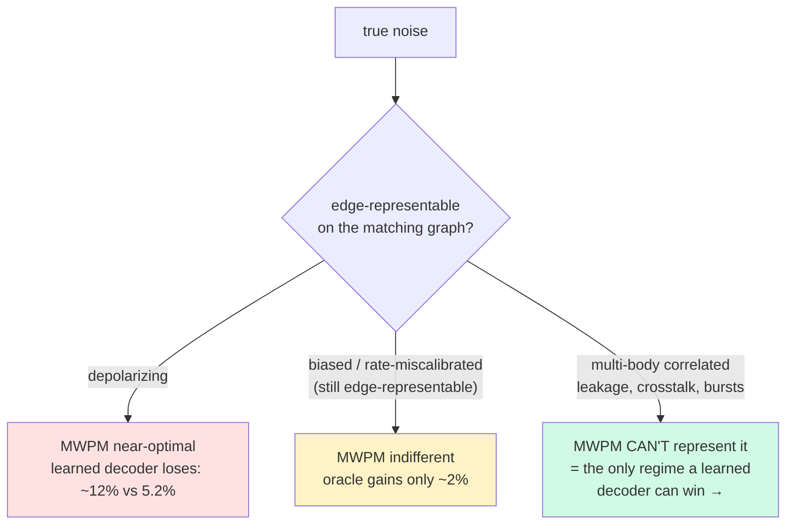

# qec-decoder

Learned quantum error-correction decoders vs classical baselines, on a
laptop. `stim` + `PyMatching` + `PyTorch`.

The question: under which noise conditions can a learned (or
data-calibrated) decoder beat minimum-weight perfect matching — the
classical decoder everyone uses?

## The problem

A logical qubit survives only if the decoder guesses the right errors:



Every decoder decodes against an **assumed noise model**. On real
hardware the true noise is different — biased, correlated, drifting:



## What we measured — where the room actually is



The first two rows are measured in this repo. The third is the next
experiment — it is also why Google's AlphaQubit only showed its
advantage on *real device* noise.

## Scripts

| Script | What it does |
|---|---|
| `qec_decoder.py` | stim surface-code circuit → sampled syndromes → MWPM vs MLP/transformer logical error rates. Flags: `--distance --rounds --noise --model {mlp,transformer,both} --mismatch` |
| `calibrated_baseline.py` | Adds the honest classical adversary: MWPM re-weighted by fitting edge probabilities from syndrome co-occurrence (Spitz et al. 1712.02360), plus biased-noise injection via `PAULI_CHANNEL_1`. Flags: `--eta --hetero --noise --distance --memory {x,z}` |

## Measured findings (d=3–5, rotated memory-Z)

```
Decoder comparison, depolarizing p=0.005, d=3, r=9:
  MWPM (calibrated):        5.2%
  Transformer decoder:     11.9%
  MLP decoder:             12.5%

Weight-miscalibration study (calibrated_baseline.py):
  MWPM, 4x wrong rate prior, d=3:          ~4.6%  (unchanged)
  Uniform X-bias eta=100, d=3:     naive 5.74% = oracle 5.74%
  Hetero X/Z-bias eta=100, d=3:    naive 4.57% = oracle 4.57%
  Hetero X/Z-bias eta=100, d=5:    naive 13.55%, oracle 13.29% (~2% rel)
```

**Honest reading.** Under correctly-calibrated i.i.d. depolarizing noise,
MWPM is near-optimal and a small learned decoder underperforms it — that
is the expected result, not a failure. More interesting: MWPM's logical
error rate is essentially *insensitive* to edge-weight miscalibration
whenever the true noise is still edge-representable (uniform AND
alternating bias). Weight fitting only has room to matter where noise is
*not* edge-representable — multi-body correlated faults. See `DESIGN.md`.

## Run

```bash
uv venv .venv --python 3.11
uv pip install -r requirements.txt

.venv/bin/python qec_decoder.py --model both
.venv/bin/python calibrated_baseline.py --eta 1.0          # sanity
.venv/bin/python calibrated_baseline.py --eta 100 --hetero # structural mismatch
```

`one-pager.html` is a self-contained summary of the problem and findings.

## Roadmap

`DESIGN.md` — noise suite (biased, drift, burst), calibrated-MWPM
baseline, ConvNet/hybrid decoders, threshold curves. License: Apache-2.0.
